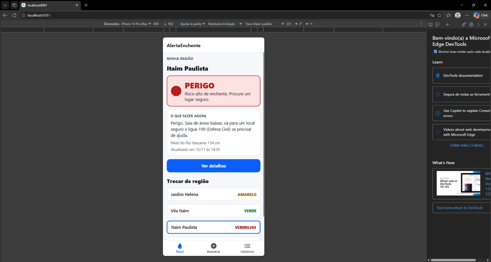
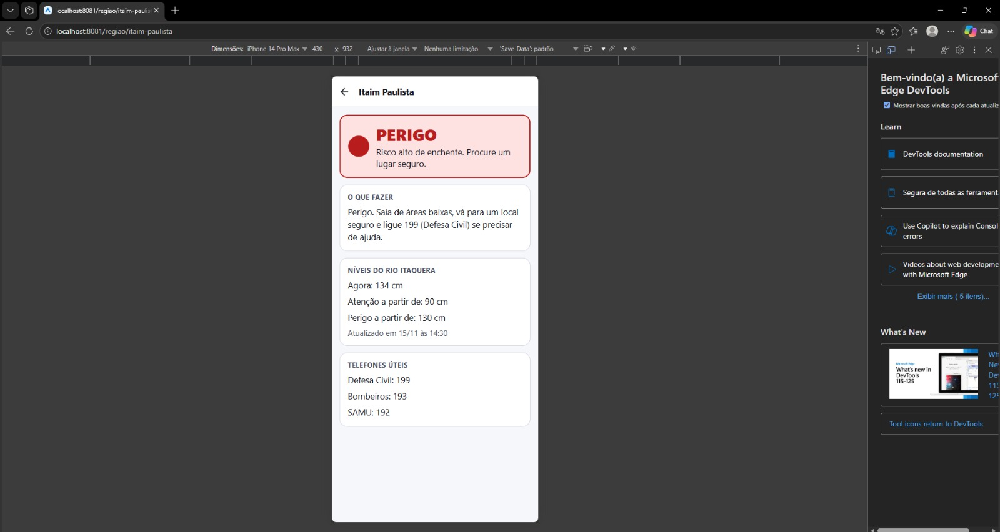
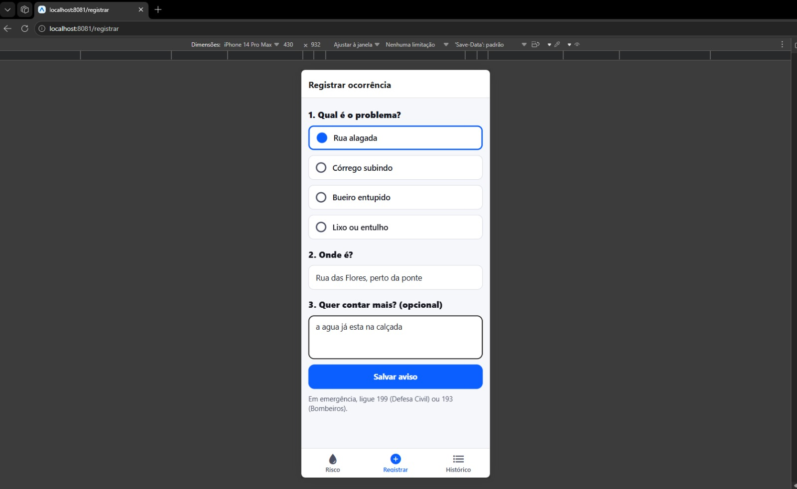
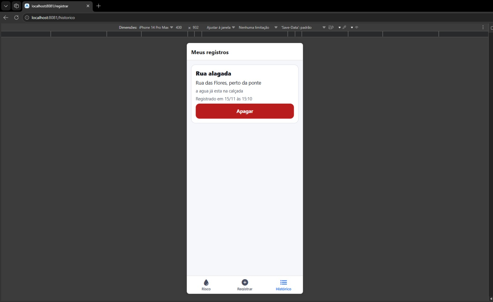

# AlertaEnchente · App Mobile (CitizenTech)

Entrega de **Mobile Development & IoT** · FIAP · Engenharia de Software (3º ano) · Global Solution 2026.2

App em **Expo (React Native + TypeScript + Expo Router)** que leva o AlertaEnchente ao celular do morador de área alagável.

## Equipe

| Integrante | RM |
|---|---|
| Arthur Silva | RM553320 |
| Eduardo Escudero | RM556527 |
| Leonardo Prado | RM556824 |
| Davi Vieira | RM556798 |
| Luca Monteiro | RM556906 |

**Nome do grupo:** AlertaEnchente

## Ficha da CitizenTech

| Campo | Preenchimento |
|---|---|
| Nome da CitizenTech | AlertaEnchente |
| Cidade e bairro | São Paulo, Jardim Helena (Zona Leste) |
| Cidadão beneficiado | Moradores e pequenos comerciantes de áreas alagáveis |
| Problema, em uma frase | Moradores de áreas alagáveis recebem os avisos de enchente tarde demais para proteger pessoas e bens. |
| Como funciona | O app mostra, com um farol verde, amarelo ou vermelho, o risco de enchente na região do morador, diz o que fazer em linguagem simples e permite registrar problemas (rua alagada, bueiro entupido, córrego subindo) que ficam salvos no celular. |
| O que cada parte faz | Mobile (este repositório): consulta e registro pelo celular. Cybersecurity: protege dados pessoais. Infraestrutura Linux: hospeda e monitora. Demais disciplinas: API, sensores e previsão de risco. |
| Indicador de impacto | Tempo entre o aviso e o morador ler a orientação; número de ocorrências registradas por região |
| ODS conectados | ODS 9, ODS 11 e ODS 13 |

## Jornada principal do cidadão

1. Abre o app e vê **na hora** o risco da sua região (farol + frase curta + o que fazer).
2. Se vir um problema, abre **Registrar**, escolhe o tipo, diz onde é e salva.
3. Em **Histórico** confere (e apaga, se quiser) o que já registrou.

## Telas

| Tela | Rota | O que faz |
|---|---|---|
| Risco | `app/(tabs)/index.tsx` | Farol da região escolhida, orientação, nível do córrego, troca de região, puxar para atualizar |
| Detalhes da região | `app/regiao/[id].tsx` | Cotas de atenção e perigo, orientação e telefones úteis (199, 193, 192) |
| Registrar | `app/(tabs)/registrar.tsx` | Formulário em 3 passos com validação |
| Histórico | `app/(tabs)/historico.tsx` | Lista salva no SQLite, com confirmação antes de apagar |

Navegação com **Expo Router**: abas (Risco, Registrar, Histórico) e uma tela empilhada de detalhes.

## Consumo de dados (API ou mock)

`src/api.ts` busca `GET {EXPO_PUBLIC_API_URL}/regioes`. Se a variável não existir ou a rede falhar, usa o mock `src/mock/regioes.json` (o app continua funcionando offline) e avisa na tela de onde vieram os dados. O formato esperado da API é o mesmo do mock.

Regra do farol (`src/risco.ts`): **verde** abaixo da cota de atenção, **amarelo** entre atenção e perigo, **vermelho** acima da cota de perigo.

## Banco de dados (SQLite local)

`src/db.ts` usa `expo-sqlite` com duas tabelas:

- `ocorrencias(id, tipo, local, descricao, criado_em)`: CRUD de registros do cidadão (criar, listar, apagar);
- `preferencias(chave, valor)`: lembra a região escolhida, mesmo depois de fechar o app.

## Acessibilidade

- Fonte base de 18 px e títulos grandes; botões com no mínimo 56 px de altura.
- O estado do farol vai em **texto** (TRANQUILO, ATENÇÃO, PERIGO), não só em cor.
- Contraste alto (texto escuro sobre fundo claro) e `accessibilityLabel`, `accessibilityRole`, `accessibilityState` e `accessibilityHint` nos controles, para leitores de tela (TalkBack e VoiceOver).
- Mensagens de erro e de sucesso com `accessibilityLiveRegion`.
- Linguagem simples, sem termos técnicos, pensando em um cidadão de 60 anos.

## Como rodar

Pré-requisitos: Node 20+ e o app **Expo Go** no celular (Android ou iPhone).

```bash
# 1. criar o projeto base (já vem com TypeScript e Expo Router)
npx create-expo-app@latest alerta-enchente
cd alerta-enchente

# 2. instalar o banco local
npx expo install expo-sqlite

# 3. trocar o código do template pelo deste repositório
rm -rf app components constants hooks scripts
#    copie as pastas  app/  e  src/  deste repositório para dentro de alerta-enchente/

# 4. rodar
npx expo start
```

Leia o QR code com o Expo Go (Android) ou com a câmera (iPhone). Celular e computador devem estar na mesma rede Wi-Fi. Se a rede bloquear, use `npx expo start --tunnel`.

Para usar uma API real: `EXPO_PUBLIC_API_URL=http://SEU-IP:8080 npx expo start`.

## Prints das telas

| Risco | Detalhes | Registrar | Histórico |
|---|---|---|---|
|  |  |  |  |

## Estrutura

```
app/                  rotas (Expo Router)
  _layout.tsx         pilha principal
  (tabs)/             abas: index, registrar, historico
  regiao/[id].tsx     detalhes da região
src/
  api.ts              API com fallback para mock
  db.ts               SQLite (ocorrências e preferências)
  risco.ts            regra do farol e formatação
  components/         Farol, Botao
  mock/regioes.json   dados de demonstração
```

## Uso de IA

O grupo usou o Claude para estruturar o código. Todos os integrantes revisaram e conseguem explicar cada parte.

## Vídeo

https://youtube.com/shorts/MHAJQhTQRsw
